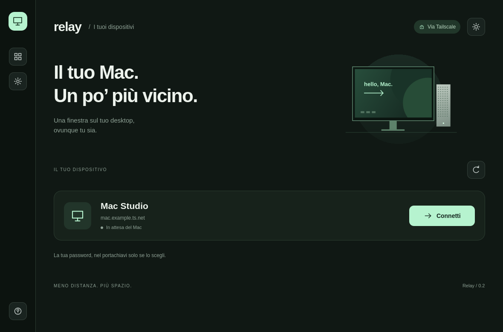
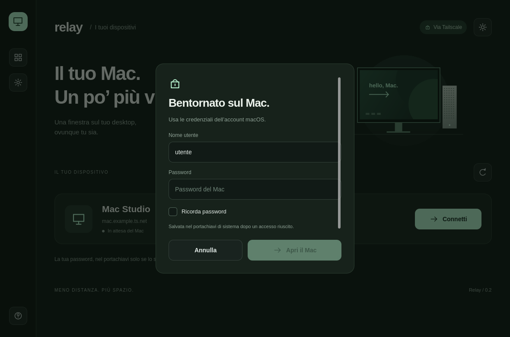

# Relay

**Il tuo Mac. Un po’ più vicino.**

Un client VNC per Linux, scritto in C++ e Qt Quick, con un’interfaccia minimale
pensata per Wayland e Omarchy. Collegati al desktop del Mac attraverso Tailscale
o una rete locale fidata.



## Cosa fa

- Interfaccia chiara e scura, icone integrate e layout adattabile alla finestra.
- Desktop remoto ridimensionato sulla GPU, mouse, tastiera e cursore locale.
- Profilo **Fluido** con colori a 16 bit e compressione per collegamenti Internet;
  **Qualità** mantiene tutte le sfumature a 24 bit.
- **Ricorda password**, facoltativo, con il portachiavi di sistema.
- Schermo intero con F11 e salvataggio delle schermate in `Immagini/Relay`.
- Ctrl → Command e Alt → Option; la conversione di Ctrl si può disattivare.

La versione attuale gestisce un solo dispositivo e una sola sessione VNC.
Non include RDP, trasferimento file o sincronizzazione degli appunti fra i computer.
L’interfaccia è in italiano. Sviluppato e verificato su Arch Linux / Omarchy.

## Installazione su Arch Linux

Installa le dipendenze:

```sh
sudo pacman -S --needed gcc make pkgconf qt6-base qt6-declarative qt6-wayland qt6-svg libvncserver libsecret python inter-font
```

Per ricordare le password serve un servizio compatibile con Secret Service,
come GNOME Keyring, avviato nella sessione desktop e con il portachiavi sbloccato.
Se il desktop non lo fornisce già, installa `gnome-keyring` e configurane
l’avvio secondo le istruzioni della tua distribuzione. Relay non modifica
l’avvio della sessione né crea un archivio alternativo di password.

```sh
git clone https://github.com/turinglabsorg/relay.git
cd relay
make -j2
python install.py
```

L’installer riguarda solo l’utente corrente. Copia il binario in `~/.local/bin`,
l’icona e il launcher nelle cartelle XDG dell’utente. Cerca **Relay** nel launcher.
Per aggiornare, esegui `git pull`, ricompila e ripeti l’installazione.
Puoi anche avviare direttamente `./build/relay -platform wayland`.

## Primo collegamento

1. Attiva **Condivisione schermo** nelle impostazioni del Mac.
2. Per collegamenti fra luoghi diversi, connetti entrambi i computer a Tailscale.
3. In Relay premi **Configura** e inserisci il nome MagicDNS o l’IP del Mac,
   la porta VNC (di solito `5900`) e il nome dell’account macOS.
4. Premi **Connetti** e inserisci la password nell’app.

Nessun indirizzo o account personale è incluso nei sorgenti. Le immagini di
questo README usano un profilo dimostrativo.
Il trasporto VNC non aggiunge una VPN: per l’accesso via Internet usa Tailscale.
La latenza della rete e un eventuale relay Tailscale influenzano la reattività;
il profilo Fluido riduce i dati senza cambiare la risoluzione del Mac.

## Password e preferenze



**Ricorda password** è disattivato per un nuovo account. Se lo selezioni,
Relay salva la password nel portachiavi **dopo un accesso riuscito** e la recupera
agli accessi successivi. Le voci sono separate per host, porta e nome utente.
Le operazioni del portachiavi avvengono in un thread separato.

Nelle impostazioni, **Dimentica password** elimina la voce del profilo attuale.
Se togli la spunta a **Ricorda password** e avvii il collegamento, Relay richiede
la rimozione della password già salvata. Annullare il dialogo non cambia la scelta.
Se il portachiavi non è disponibile o la rimozione fallisce, l’app lo segnala;
puoi continuare inserendo la password manualmente.

Le preferenze sono in `~/.config/Relay/Relay.conf`, oppure sotto
`XDG_CONFIG_HOME`. Questo file contiene il profilo e un indicatore di salvataggio,
mai la password. Il profilo locale non va aggiunto al repository.
Le impostazioni di connessione e qualità si applicano alla prossima sessione.
Le scorciatoie intercettate da Hyprland restano riservate al desktop Linux.

## Sviluppo e test

```sh
sudo pacman -S --needed dbus gnome-keyring
make test
```

I test VNC usano un server RFB locale e una configurazione temporanea. Verificano
negoziazione, mouse e tastiera, resize, disconnessione, autenticazione rifiutata,
frame lenti, annullamento di letture incomplete, messaggi prefetched, Zlib,
cursori trasparenti, RGB565 con larghezze dispari e limiti del framebuffer.
Controllano anche i pixel disegnati e le bande laterali prima e dopo un resize.

I test grafici renderizzano home, accesso, impostazioni e guida nei due temi,
a tre dimensioni fino a `640×440`, senza catturare il desktop dell’utente.
I test password creano un bus D-Bus e un portachiavi usa e getta, con credenziali
sintetiche: non accedono al portachiavi personale.

Per provare il renderer sul desktop Wayland, con una breve finestra di test:

```sh
RELAY_TEST_PLATFORM=wayland python tests/test_vnc.py low-bandwidth zlib-cursor
```

QML e icone sono incorporati nel binario. Il client usa LibVNCClient per
CopyRect, Tight/JPEG, Zlib, ZRLE, Hextile e Raw, secondo il server.
Il log contiene solo statistiche aggregate di ricezione e attesa degli input;
non registra schermate, tasti o password.

Se il tuo tema Hyprland applica trasparenza a tutte le finestre, configura
un’eccezione con opacità `1.0` per la classe `io.relay`. L’installer non modifica
le regole del window manager.
